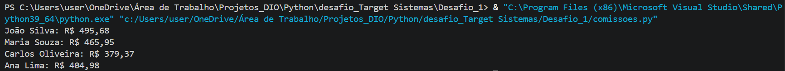
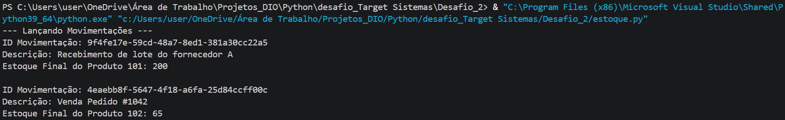
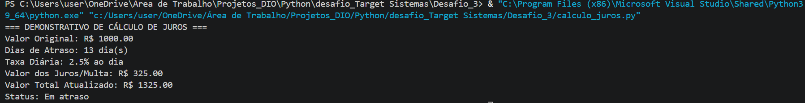

# 🚀 Desafios Práticos em Python - Target Sistemas

Este repositório reúne as soluções para três desafios práticos de programação, cobrindo cálculo de comissões com precisão monetária, gestão de controle de estoque e cálculo de juros diários por atraso.

Todas as soluções foram desenvolvidas utilizando a linguagem **Python 3**, aplicando princípios de **Código Limpo (Clean Code)**, tratamento de erros, validações e boas práticas do paradigma orientado a objetos.

---

## 🛠️ Tecnologias e Conceitos Aplicados

- **Linguagem:** Python 3.9+
- **IDE:** Visual Studio Code (VS Code)
- **Módulos Nativos do Python:**
  - `decimal`: Para precisão absoluta em operações financeiras e monetárias sem erros de ponto flutuante.
  - `uuid`: Para geração de identificadores únicos universais (UUID v4).
  - `datetime`: Para manipulação e operações aritméticas com datas.
  - `enum`: Para criação de enumerações fortemente tipadas (`TipoMovimentacao`).
  - `json`: Para parsing e manipulação de payloads de dados.
  - `sys`: Para leitura de argumentos passados via linha de comando (CLI).
  - `collections.defaultdict`: Para agrupamento eficiente de totais por vendedor.
- **Boas Práticas de Engenharia de Software:**
  - Princípio da Responsabilidade Única (SRP - SOLID)
  - Cláusulas de guarda (*Fail Fast*) para validação de entradas
  - Ausência de "números mágicos" (substituídos por constantes descritivas)
  - Tipagem estática com *Type Hints*

---

## 📁 Estrutura do Repositório

```text
.
├── Desafio_1/
│   ├── comissoes.py
│   └── vendas.json
├── Desafio_2/
│   └── estoque.py
├── Desafio_3/
│   └── calculo_juros.py
├── image_781da3.png
├── image_781a1a.png
├── image_78163c.png
└── README.md
```

---

## 💻 Exercícios e Soluções Detalhadas

### 📌 Exercício 1: Cálculo de Comissões do Time de Vendas

#### **Regra de Negócio:**
A partir de um payload JSON contendo o histórico de vendas de um time comercial, o programa calcula a comissão individual de cada vendedor acumulando o valor por transação segundo as regras:
- Vendas **abaixo de R$ 100,00**: **0%** de comissão (isentas).
- Vendas de **R$ 100,00 até R$ 499,99**: **1%** de comissão.
- Vendas a partir de **R$ 500,00**: **5%** de comissão.

#### **Destaques da Solução (`comissoes.py`):**
- Utilização de `decimal.Decimal` em conjunto com `parse_float=Decimal` na leitura do JSON, garantindo que não ocorram imprecisões de arredondamento comuns no tipo `float`.
- Separação clara de funções: leitura de arquivo, cálculo por venda individual, agregação por vendedor e formatação em moeda nacional (BRL).

📸 **Resultado da execução no VS Code:**


---

### 📌 Exercício 2: Lançamento e Controle de Movimentações de Estoque

#### **Regra de Negócio:**
O programa gerencia o estoque de produtos em depósito partindo de um estado inicial em JSON. O sistema permite realizar lançamentos de **Entrada** ou **Saída** de mercadorias, cumprindo os requisitos:
- Cada movimentação possui um **número identificador único** (UUID v4).
- Cada movimentação possui uma **descrição textual** que identifica o motivo/tipo da operação.
- Retorna o **saldo final atualizado** do estoque do produto movimentado ao término de cada lançamento.

#### **Destaques da Solução (`estoque.py`):**
- Arquitetura orientada a objetos composta pelas classes `MovimentacaoEstoque` (domínio do evento) e `GerenciadorEstoque` (regra de negócios do depósito).
- Validação antecipada de segurança: impede saídas que superem o saldo disponível em estoque (*insufficient stock*) e impede operações em produtos inexistentes.
- Uso de `Enum` para restringir o tipo de operação a valores válidos (`ENTRADA` / `SAIDA`).

📸 **Resultado da execução no VS Code:**


---

### 📌 Exercício 3: Cálculo de Juros Diários por Atraso em Titulos

#### **Regra de Negócio:**
A partir do valor original de um título e de sua data de vencimento, o programa calcula o valor total dos juros acumulados até a data de hoje, aplicando uma taxa de **2,5% ao dia** em caso de atraso.

#### **Destaques da Solução (`calculo_juros.py`):**
- Classe `CalculadoraJuros` encapsulando a regra financeira.
- Suporte a parsing flexível de datas (aceita objetos `datetime.date` ou strings no formato ISO `YYYY-MM-DD`).
- **Injeção da data de referência:** Permite passar uma data arbitrária para simulador/testes unitários, sem acoplar rigidamente ao relógio do sistema.
- Se o pagamento for efetuado no prazo ou antes do vencimento, o cálculo retorna juros zerados automaticamente.

📸 **Resultado da execução no VS Code:**


---

## 🚀 Como Executar os Projetos Localmente

### **Pré-requisitos:**
- Python 3.9 ou superior instalado em sua máquina.
- Git instalado.

### **1. Clonar o Repositório**
```bash
git clone https://github.com/seu-usuario/seu-repositorio.git
cd seu-repositorio
```

### **2. Executando o Desafio 1 (Comissões)**
Você pode passar o caminho do arquivo JSON como argumento via CLI ou deixar o arquivo `vendas.json` na mesma pasta do script:
```bash
python Desafio_1/comissoes.py Desafio_1/vendas.json
```

### **3. Executando o Desafio 2 (Movimentação de Estoque)**
```bash
python Desafio_2/estoque.py
```

### **4. Executando o Desafio 3 (Cálculo de Juros)**
```bash
python Desafio_3/calculo_juros.py
```

*(Nota: Dependendo da configuração do seu ambiente Windows/Linux/Mac, utilize `python3` no lugar de `python`).*